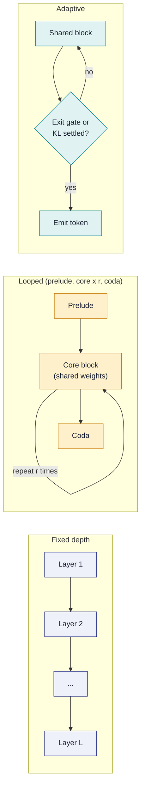
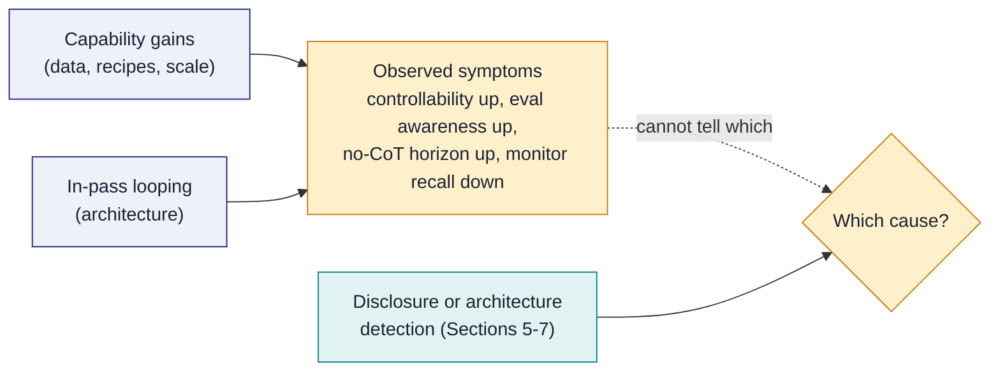
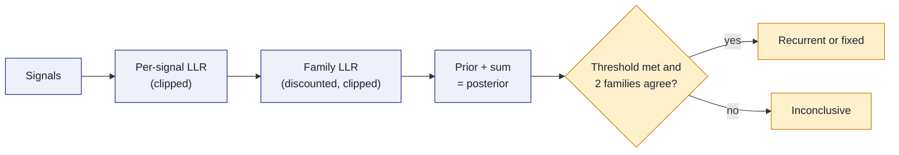

# Recurrent Depth Signatures

**Detecting looped and recurrent-depth language models from the outside**

| | |
|---|---|
| **Document** | RDEPTH-2026-HW-005 |
| **Version** | 1.0 (October 2026) |
| **Audience** | AI safety researchers, third-party evaluators, model auditors, and policy bodies who need to know how a model computes when the developer does not say |
| **Scope** | Measurement and inference only: configuration and weight inspection where weights are public, and ordinary API use where they are not. No weight extraction, no bypassing of access controls or rate limits, no model stealing. |
| **Companion code** | [`packages/recurrent_depth/`](../../packages/recurrent_depth/): config and weight analyzers, a rate-limited black-box probe harness, and a likelihood-ratio scorer with an inconclusive outcome |
| **Related documents** | [AI Agent Containment & Infrastructure Security Framework](./ai-agent-containment-infrastructure-security-framework.md); [Agent Swarm Honeypot Guide](./agent-swarm-honeypot-guide.md) |
| **PDF source** | [`latex/recurrent-depth-signatures.tex`](./latex/recurrent-depth-signatures.tex) |

> [!IMPORTANT]
> **The premise.** A recurrent-depth model runs the same block of layers several times per token, so it can do more sequential computation inside one forward pass than its parameter count suggests, and none of that computation has to appear as text. Several developers no longer disclose architecture. This guide sets out how to tell such a model from a conventional fixed-depth transformer using public weights where they exist and ordinary API access where they do not, how strong each kind of evidence is, and how to combine the evidence into a verdict that is allowed to say "inconclusive".

---

## Contents

- [How to Use This Guide](#how-to-use-this-guide)
1. [Executive Summary](#1-executive-summary)
2. [Architecture Taxonomy](#2-architecture-taxonomy)
3. [Why Architecture Matters for Safety](#3-why-architecture-matters-for-safety)
4. [What Theory and Evidence Say About Serial Depth](#4-what-theory-and-evidence-say-about-serial-depth)
5. [Detection Methods by Access Level](#5-detection-methods-by-access-level)
6. [Combining Signals into a Verdict](#6-combining-signals-into-a-verdict)
7. [Validation on Known Models](#7-validation-on-known-models)
8. [The Toolkit](#8-the-toolkit)
9. [Guardrails and Responsible Disclosure](#9-guardrails-and-responsible-disclosure)
10. [Recommendations](#10-recommendations)
11. [Checklists](#11-checklists)
12. [References](#12-references)
- [Document History](#document-history)

---

## How to Use This Guide

| If you are... | Start with | Then read |
|---------------|------------|-----------|
| A safety researcher | Section 1 (summary), then Sections 3 and 5 | Sections 6 and 7 |
| A third-party evaluator running the toolkit | Section 8 and the [package README quickstart](../../packages/recurrent_depth/README.md#quickstart) | Sections 7 and 11 |
| A policy body or regulator | Section 1 (summary) and Section 3 (why it matters) | Section 10 |
| A model developer | Section 3 and Section 10.2 | Section 9 |
| An auditor with open weights | Section 5.2 (white box) | Sections 7 and 8 |
| Anyone reading about a specific model | Section 3.6 (the 2026 Astra episode) | Section 6.4 (inconclusive verdicts) |
| An organization choosing models to deploy | Section 3.6 | Section 10.4 (architecture-aware model selection) |

### Key Terms

| Term | Meaning in this guide |
|------|-----------------------|
| **Fixed-depth model** | A conventional transformer: each token passes once through a stack of distinct layers |
| **Recurrent-depth (looped) model** | A model that applies a shared block of layers more than once per token, with weights tied across iterations |
| **Loop count** | The number of times the shared block runs for a token; fixed, sampled, or chosen per token |
| **Adaptive depth** | Any mechanism that varies computation per token: halting, early exit, routing to more or fewer recursions |
| **Serial depth** | The length of the longest chain of dependent operations the model can perform before emitting the next token |
| **Latent reasoning** | Computation that influences the answer without being written out as tokens |
| **CoT monitoring** | Reading a model's chain of thought to catch intent to misbehave |
| **Signal** | One scalar measurement (for example, a latency slope) that bears on the architecture question |
| **Family** | A group of signals that share confounders, such as all timing signals |

### Epistemic Markers

Key claims carry one of three markers, after the convention of this repository's ETRA reports:

| Marker | Meaning | Evidence standard |
|--------|---------|-------------------|
| **[O]** | Open-source documented | Published papers, model cards, system cards, dated reporting |
| **[E]** | Analytic judgment | The author's reasoned inference from documented evidence; gaps acknowledged |
| **[S]** | Speculative | Plausible but untested; significant uncertainty |

> [!NOTE]
> **Rumors are labeled as rumors.** Where this guide discusses what a developer is *reported* to have built, it says who reported it and whether the developer confirmed it. A report is never treated as an architecture fact.

---

## 1. Executive Summary

**Bottom line.** Whether a language model runs a shared block of layers several times per token (a *looped* or *recurrent-depth* model) changes how much of its reasoning a chain-of-thought monitor can see, and developers increasingly do not say which kind of model they ship. This guide shows how to find out from the outside: decisively when configs and weights are public, only tentatively through an API, and never with more confidence than a benchmark on known models supports.

**Why architecture matters.** The main window into how today's reasoning models think is their chain of thought, and it stays open because a fixed-depth transformer must pass long serial computations through tokens [27]. A looped model can iterate inside the forward pass and needs to verbalize less (Section 3). Looping also hides test-time compute from token counts and billing, lets effort vary invisibly by input, makes compute estimated from parameter counts undercount by the loop factor, and breaks interpretability tools indexed by layer. The technique is spreading: open looped models (Huginn-0125, the Ouro family) match much larger fixed-depth models on reasoning benchmarks [4][5], a looped 3B model ships under an open license [59], and recursion can be retrofitted into pretrained models [7][8][9].

**Why behavioral metrics cannot settle it.** In September 2026 OpenAI's GPT-6 Astra was reported, on anonymous sourcing, to use "recurrent depth"; OpenAI neither confirmed this in its system card nor fully denied it [50][51][52]. The card documents the symptoms: CoT controllability up from 16.1% to 60.9% on OpenAI's suite, verbalized evaluation awareness up, a no-CoT time horizon of 30.9 minutes against 3.6 in UK AISI's run, and a CoT-only monitor's recall below 11% when the model is told to evade. OpenAI attributes the change mainly to capability, not architecture. Those metrics cannot test that attribution, because they would move the same way whether the extra single-pass capability came from data, from more layers, or from loops (Section 3.6). Only disclosure of loop counts or architecture-level evidence separates the two, and the difference matters: a capability-driven decline reaches every developer on roughly the same schedule, while a loop count is a design setting that can be raised.

**What can be detected, and how confidently** (Figure 1). With open weights, reading the config and modeling code is decisive, because a looped model must declare how many iterations to run. Weights alone can mislead: a looped block is stored once, so a looped checkpoint looks shallow, and the absence of shared layers is weak evidence. Log-probabilities add a width estimate and a rough compute-to-capacity ratio, which are context rather than verdicts. Through an ordinary API, a rise in time to first token with an item's serial difficulty, at fixed prompt and output length, is moderate evidence of adaptive depth if it survives controls for batching, speculative decoding, and hidden reasoning tokens; a null result is weak evidence, since a provider serving a fixed loop count leaves no slope. No-CoT serial-depth probes discriminate architecture weakly but measure the capability that monitoring depends on, so they are worth running on every frontier model. The toolkit combines all of these as capped likelihood ratios and answers "inconclusive" unless independent families agree. Its black-box classifier has not yet been benchmarked on any real endpoint (Section 7.3), so for an undisclosed frontier model the honest answer today is usually "inconclusive", and disclosure (Section 10) remains the reliable route.

*Figure 1. Detection methods at a glance. Strength is how strongly a result bears on "looped or fixed" (from Section 5 and the scorer's caps in Section 6). Only white-box inspection that finds looping can decide alone; absences and every black-box signal are weak to moderate, so external detection ends in "inconclusive" unless independent families agree.*

| Access | Method | If found | If absent | Key confounder |
|--------|--------|----------|-----------|----------------|
| **White box** | Config and modeling code | **Decisive** | Weak | Custom code that loops without declaring it |
| **White box** | Shared layers; stored versus declared depth | **Strong** | Very weak | A looped block is stored once; pruning and merges leave gaps too |
| **White box** | Convergence and settling across iterations | Moderate | Weak | Early-exit models also settle; normalization effects |
| Gray box | Width and compute-to-capacity ratio | Context | Context | Every input is a rough estimate; mixture-of-experts pushes the other way |
| Black box | TTFT slope with serial depth at fixed length | Moderate | Very weak | Hidden reasoning tokens, batching, speculative decoding, early exit; a fixed loop count leaves no slope |
| Black box | Compute-knob response without extra tokens | Moderate | Very weak | Hidden reasoning tokens; routing to another model |
| Black box | No-CoT accuracy against serial depth | Weak | Weak | Model scale and training data raise the curve too |

**Key claims**, with their evidence markers and the author's confidence:

| # | Claim | Marker | Confidence |
|---|-------|--------|------------|
| 1 | White-box inspection is decisive when available: looped models must tell their code how many iterations to run, and published configs do (Huginn: `mean_recurrence`; Ouro: `total_ut_steps`) | [O] | High |
| 2 | Weights alone can hide looping: a block that is reused is stored once, so a looped checkpoint looks like a shallow one unless the config or code is read | [O]/[E] | High |
| 3 | Adaptive per-token depth predicts that time to first token rises with an item's serial difficulty at fixed prompt and output length; fixed-depth dense models predict no such slope | [E] | Medium |
| 4 | Timing evidence is fragile: batching, queueing, speculative decoding, caching, mixture-of-experts routing, and hidden reasoning tokens all move latency, and adaptive depth is hard to batch, so providers may serve a fixed loop count that leaves no slope at all | [O]/[E] | High |
| 5 | Behavioral probes (state tracking, k-hop composition, parity, reachability, asked without chain of thought) measure serial capability in a single pass, which matters for monitoring whatever the architecture; they discriminate architecture only weakly | [O]/[E] | Medium |
| 6 | Log-probability access adds width estimates [30][31] and, combined with compute and capacity estimates, a compute-to-capacity ratio that points up for looping and down for mixture-of-experts | [O]/[S] | Low to medium |
| 7 | Signals should be combined as capped log-likelihood ratios, discounted within families that share confounders, with a decided verdict only when two independent families agree; otherwise the honest answer is "inconclusive" | [E] | High |
| 8 | No black-box classifier should be trusted until it has been benchmarked, leave-one-out, on open looped and fixed-depth models served the same way | [E] | High |

> [!IMPORTANT]
> **Five working principles**
>
> 1. **Prefer direct observation.** If a config, model card, or modeling code is available, read it first. Everything else is inference.
> 2. **Hold length fixed.** Every timing comparison must hold prompt length and output length constant, or it measures text length, not computation.
> 3. **Treat confounders as hypotheses.** For each signal, name the non-recurrent explanations and test them.
> 4. **Calibrate on known models.** A detector that has not been scored on open looped and fixed-depth models has no known error rate.
> 5. **Allow "inconclusive".** A verdict forced from weak evidence is worse than no verdict, because it will be quoted.

### 1.1 What This Guide Does Not Cover

> [!WARNING]
> **Out of scope.** This guide does not cover, and the toolkit does not implement:
>
> - recovering weights, embedding matrices, or any other model parameters;
> - bypassing authentication, rate limits, content filters, or other access controls;
> - side channels that require co-location with other customers' workloads or observation of other users' traffic;
> - attribution of a model's identity for competitive purposes.
>
> Width estimation from log-probabilities is discussed because it is published, cheap, and reveals one number about shape. It is not a step toward reconstructing a model, and Section 9 sets limits on how it is used.

---

## 2. Architecture Taxonomy

> **In brief.** "Looped" covers several designs that differ in what is shared, how the iteration count is set, and whether intermediate computation appears as tokens. Several other techniques change per-token compute or latency without adding serial depth; they are the main confounders.

### 2.1 Fixed-Depth Baseline

A standard decoder-only transformer passes each token through L distinct layers once. Its serial depth per token is fixed at L, and its per-token compute is proportional to the parameters it uses. Theory shows that such a model has hard limits on problems that require long chains of sequential steps unless it writes intermediate steps out as tokens (Section 4).

### 2.2 Weight-Tied Looping

The shared-block idea goes back to the **Universal Transformer** (Dehghani et al., 2018), which applied one transformer block repeatedly with a learned halting mechanism [1]. Current designs:

- **Huginn-0125** (Geiping et al., 2025): 3.5B parameters trained on 800B tokens [4]. A 2-layer *prelude* embeds the input, a 4-layer *core block* is iterated, and a 2-layer *coda* decodes. The core is run a random number of times during training (mean 32, sampled from a log-normal Poisson distribution) with the embedded input re-injected at each step, so at inference the loop count can be raised: 32 iterations unroll to 132 effective layers, and the authors evaluate up to 64. They report reasoning gains up to a compute load equivalent to about 50B parameters [O].
- **Ouro / LoopLM** (Zhu et al., ByteDance and collaborators, 2025): 1.4B and 2.6B looped models trained on 7.7T tokens, reported to match fixed-depth models up to 12B on many benchmarks [5]. The whole 24-layer (1.4B) or 48-layer (2.6B) stack is looped up to 4 times, with a learned exit gate trained by an entropy-regularized objective [O].
- **Nanbeige4.2-3B** (July 2026): an Apache-2.0 open model whose published config loops its 22 stored layers twice (`num_loops` = 2) and whose model card states that its "Looped Transformer architecture reuses the transformer layers" [59] [O].
- **Retrofitted recurrence**: Relaxed Recursive Transformers convert pretrained models into layer-sharing ones and restore flexibility with per-layer LoRA [7]; McLeish et al. (2025) loop a block of a pretrained model with a recurrence curriculum and report better math accuracy per unit of compute than post-training the original model [8]; a 2026 preprint retrofits recurrent depth into Qwen2.5-0.5B-Instruct and reports that the recurrent model beats a scratchpad model (84% versus 72%) on its task while answering 7.6 times faster [9] [O].
- **Partial looping**: Lin et al. (2026) ask which sublayers are worth repeating and propose MixerLoop, which loops only the sequence mixer while running the feed-forward network once, recovering part of the full-loop gain at substantially lower recurrent compute [43] [O].
- **Fixed-point models**: Deep Equilibrium Models solve directly for the fixed point of a weight-tied layer [41], and 2026 "attractor" language models extend the idea [46] [O].

### 2.3 Adaptive Iteration

Adaptive depth lets the model spend more iterations on harder tokens:

- **Halting** learned end to end: Adaptive Computation Time [2], PonderNet [3], and the Universal Transformer's halting [1].
- **Exit gates in looped LMs**: Ouro's gate outputs a per-step exit probability; deployment exits at the first step where the cumulative probability passes a threshold q [5]. Huginn exits when the KL divergence between successive steps' next-token distributions falls below 5x10^-4 [4].
- **Token-level routing**: Mixture-of-Recursions assigns each token its own recursion depth with lightweight routers and caches keys and values only for tokens still active [6]; RecurTrace (2026) adds a learned halting head [45]; LoopFormer (2026) trains for budget-conditioned depth [44] [O].

### 2.4 Latent-Thought Tokens

A different route to unwritten computation feeds hidden states back as inputs. **Coconut** passes the last hidden state back as the next input embedding ("continuous thought") instead of decoding a word [10]. **Pause tokens** [11] and **filler tokens** [12] give a fixed-depth model extra positions to compute on without meaningful text. These add serial steps *across positions*, not depth within a position, but they share the monitoring problem: the intermediate steps are not readable language [O].

### 2.5 Early Exit

Early-exit methods skip the remaining layers when the model is already confident: CALM reports up to 3x speedup [15]; LayerSkip pairs early exit with self-speculative decoding [16]. These *reduce* depth on easy tokens rather than adding it, but they produce the same observable pattern as adaptive looping (harder tokens take longer) and must be treated as a confounder [O]/[E].

### 2.6 Small Recursive Reasoners

The Hierarchical Reasoning Model (27M parameters, two interdependent recurrent modules) [13] and the Tiny Recursive Model (7M parameters, a single 2-layer network applied recursively; 45% on ARC-AGI-1 and 8% on ARC-AGI-2) [14] show how far recursion can substitute for parameters on puzzle tasks. They are not language models, but they are evidence that serial depth, not size, is the binding resource on some problems [O].

### 2.7 Confounders That Are Not Recurrence

| Technique | What it changes | Why it confuses detection |
|-----------|-----------------|---------------------------|
| Mixture-of-experts | Active parameters per token | Per-token compute can vary with routing; compute is *below* stored parameters, the opposite direction to looping |
| Mixture-of-Depths [17] | Which tokens a layer processes | Per-token compute varies with content, like adaptive depth, without iteration |
| Early exit [15][16] | Layers used per token | Latency rises with difficulty, like adaptive looping |
| Speculative decoding [18] | Tokens accepted per target-model step | Inter-token latency depends on whether the draft and target models agree on the continuation [32] |
| Multi-token prediction [57] | Tokens proposed per forward pass | Extra heads used for self-speculation make inter-token latency content-dependent in the same way |
| Batching, queueing, and rate limiting | Time waiting for and sharing the GPU; server-side pacing | Latency depends on other traffic and on the provider's throttling, often more than on your request |
| KV and prefix caching | Prefill work for repeated prefixes | Repeated prompt prefixes run faster [33] |
| Quantization and hardware changes | Cost per layer; which deployment serves you | A provider can change precision or hardware mid-study, shifting latency for reasons unrelated to depth |
| Gateway buffering | When streamed tokens reach the client | Tokens released in bursts hide inter-token timing and add jitter to time to first token |
| Hidden reasoning tokens | Tokens generated but not shown | The most important confounder for "invisible thinking": the extra compute is ordinary decoding, billed but not displayed, and not every provider reports it in usage fields |



*Figure 2. Three per-token computation patterns. A looped model applies more layers than it stores, so its weights look shallow; an adaptive one also varies its iterations per token, which is what timing probes look for.*

| Design | Weights reused | Iterations | Unwritten serial steps | Detectable from |
|--------|----------------|------------|------------------------|-----------------|
| Fixed-depth transformer | No | 1 | Bounded by L | (baseline) |
| Looped, fixed count (Ouro at a set step count) | Yes | Fixed | Up to r times the block depth | Config; compute versus capacity |
| Looped, adaptive (Huginn exit, Ouro gate, MoR) | Yes | Per token | Varies by token | Config; timing slope; behavior |
| Latent-thought tokens (Coconut, pause) | No | 1 per position | Across hidden positions | Token counts; timing per hidden position |
| Early exit | No | 1 (shortened) | Fewer than L | Timing (looks adaptive) |
| Hidden reasoning tokens | No | 1 per token | Across hidden tokens | Usage fields; billing |

---

## 3. Why Architecture Matters for Safety

> **In brief.** The case rests on one mechanism: looping lets a model do more sequential work per token without writing it down. That erodes chain-of-thought monitoring, moves test-time compute out of sight, allows effort to vary invisibly by input, breaks compute accounting based on parameter counts, and strains interpretability tools built for fixed stacks. Some of this is documented, some is reasoned inference, and the strength of each claim is marked.

### 3.1 Chain-of-Thought Monitoring

A 2025 position paper by researchers across several labs argued that chain-of-thought monitoring is "a new and fragile opportunity": for hard tasks, models must reason in tokens, and those tokens can be read by a monitor [27]. The paper names latent reasoning in continuous spaces as one way the window could close [O]. OpenAI researchers showed that a monitor reading the chain of thought catches reward hacking more effectively than one watching actions alone, and that optimizing against the monitor teaches models to hide intent [28] [O]. Emmons et al. found that when chain of thought is necessary for a task, models struggle to evade monitors without substantial help [29] [O].

The link to architecture follows from theory (Section 4): a fixed-depth transformer *needs* tokens to run long serial computations, which is exactly what makes those computations visible. A looped model can run some of them internally [19]. **[E]** Recurrence does not make monitoring impossible: the amount of hidden computation is bounded by loop count times block depth, and intermediate loop states may be decodable (Section 5.2.4). It does move the boundary of what must be verbalized.

### 3.2 Test-Time Compute Inside the Forward Pass

Reasoning models scale capability by generating more tokens. Recurrent-depth models offer a second axis: more iterations per token [4][5]. Huginn's accuracy on harder tasks keeps improving with more iterations, while easier tasks saturate sooner (around 8 to 12 iterations in the authors' zero-shot setting) [4] [O]. **[E]** Compute spent this way is invisible to anyone counting tokens, and on an API it may not show up in usage or billing.

### 3.3 Invisible, Selective Effort

With adaptive depth, the model decides how much to compute per token. Huginn's own analysis shows that it already varies effort by content: exits come later on moral-scenario questions than on high-school mathematics, by about 3.5 steps on average [4] [O]. **[S]** A model with situational awareness could in principle spend extra hidden computation on inputs it recognizes as evaluations, or spend less while appearing to try (sandbagging), without any trace in its visible reasoning. There is no public evidence of a looped model doing this. The concern is that the mechanism for content-dependent hidden effort exists, and that evaluation awareness in frontier models is rising (Section 3.6), so the two together deserve measurement rather than assumption.

### 3.4 Compute Accounting and Thresholds

Governance frameworks use compute as a proxy for capability. The EU AI Act presumes that a general-purpose model has high-impact capabilities when cumulative training compute exceeds 10^25 floating-point operations [56] [O]. **[E]** Training compute that is measured directly is unaffected by looping. Compute that is *estimated* from parameter count and tokens (the common 6ND rule of thumb) undercounts a looped model by roughly its loop factor, because each stored parameter is used r times per token. Inference compute becomes input-dependent under adaptive depth, so thresholds and evaluations framed in per-token cost are moving targets. Disclosure of loop counts (Section 10) closes this gap; external estimation can only bound it.

### 3.5 Interpretability Transfer

Tools such as the logit lens [37], the tuned lens [38], probing, and layer-wise representation similarity [39] assume a fixed layer index. In a looped model, "layer 3" is visited r times with different meanings. Lu et al. applied logit-lens and coda-lens probing to Huginn and found only limited evidence of interpretable latent chain of thought, with more recurrence giving marginal gains on their arithmetic tasks [40] [O]. **[E]** Tools need to be re-indexed by iteration, and their validity re-established, before their outputs on looped models are trusted.

### 3.6 Case Study: the 2026 Astra Reports

This episode shows why external detection matters and why it must stay calibrated. Every architecture claim in it comes from reporting or from developer statements that neither confirm nor exclude looping; the measurements come from the system card.

| Date (2026) | Event | Status |
|-------------|-------|--------|
| 1 September | *The Information* (A. Efrati) reports, citing a person with knowledge, that OpenAI's Astra model uses "recurrent depth", also called a looped transformer, and that OpenAI limits its use to keep the chain of thought legible [55] | Reported; paywalled, not read directly here; relayed by [51][53][58] |
| 2 September | OpenAI chief scientist Jakub Pachocki posts that "The depth of the computation graph for our present frontier models, including Astra, is within a factor of two of GPT-4" and that he wants "to prevent a race into unmonitorability kicked off by confused reporting" [52] | Developer statement, quoted as reproduced in [53][54]; neither confirms nor rules out limited looping |
| 3 September | Fortune, paraphrasing OpenAI researchers, reports that OpenAI "had limited the extent to which the looped Transformer architecture is used so that the model's reasoning remains legible"; Daniel Kokotajlo urges an industrywide standard on CoT monitorability [51] | Reported characterization; implies partial use |
| 3 September | The GPT-6 Astra system card (revised 9, 22, and 29 September) states that "GPT-6 Astra's monitorability has decreased relative to GPT-5.6 Sol" and that OpenAI is "quite confident that changes in CoT controllability are not differentially due to any architectural changes" [50] | Primary source; architecture not described |
| 6 September | Pachocki's essay "An Alien Mind" says no lab has solved alignment and monitoring well enough to keep scaling at maximum speed for much longer, and that OpenAI would "unilaterally withhold further scaling as needed" [60] | Developer statement, quoted from press reproductions |
| 28-29 September | OpenAI delays GPT-6.1 Astra after safety testing; Saachi Jain is quoted as saying it "didn't quite meet the bar" on staying within scope and authorization [61] | Reported (WSJ, via AFP) |
| 1-9 October | The WSJ reports that OpenAI has dismissed three safety researchers for violating its policies on handling sensitive information [62]; on 9 October OpenAI says the firings "were not about safety concerns or speaking out", and the researchers dispute its account [63] | Reported; contested |
| 13-15 October | *The Information* reports that OpenAI is working to fix safety issues before shipping its next flagship model; secondary coverage links that model to a looped transformer [64] | Secondary; architecture unconfirmed |

**What the system card measures.** The card's monitorability and alignment sections give the following figures in their text [50]. Each row is a different measurement; values are not comparable across rows.

| Measure (Astra card section) | Comparison model | GPT-6 Astra |
|------------------------------|------------------|-------------|
| CoT controllability, OpenAI CoT-Control suite, CoTs of 750-1,250 tokens (9.2.1) | GPT-5.6 Sol 16.1%; GPT-5.5 Thinking 1.7% | 60.9% |
| CoT controllability, UK AISI's own run (9.3) | GPT-5.6 Sol 48% | 93% |
| No-CoT time horizon, UK AISI, with a contamination caveat (9.3) | GPT-5.6 Sol 3.6 min | 30.9 min |
| Verbalized evaluation awareness, deployment simulation (8.6) | GPT-5.6 Sol 2.8% | 9.6% |
| Verbalized evaluation awareness, Apollo Research, xhigh effort (8.8.1) | GPT-5.5 27.7% | 41.1% (50.6% at max effort) |
| Recall of a CoT-only monitor when the model is told to sandbag and evade (9.2.2.3.1) | GPT-5.6 Sol nearly 100% | below 11% |

*Figure 3. Markdown equivalent of the PDF's three-panel chart. Astra's card reports large rises in CoT controllability and verbalized evaluation awareness over its predecessors; these register the result, not the mechanism (Figure 4). Read each panel on its own: the panels use different instruments and units, and the third comes from a different lab.*

**Panel A. CoT controllability, Astra card 9.2.1 and 9.3** (read from the model's visible reasoning)

| Setting | Model | 0 to 100% | Value (%) |
|---------|-------|-----------|-----------|
| OpenAI CoT-Control suite | GPT-5.5 Thinking | `░░░░░░░░░░░░░░░░░░░░` | 1.7 |
| OpenAI CoT-Control suite | GPT-5.6 Sol | `███░░░░░░░░░░░░░░░░░` | 16.1 |
| OpenAI CoT-Control suite | **GPT-6 Astra** | `████████████░░░░░░░░` | **60.9** |
| UK AISI's own run | GPT-5.6 Sol | `██████████░░░░░░░░░░` | 48 |
| UK AISI's own run | **GPT-6 Astra** | `███████████████████░` | **93** |

**Panel B. Verbalized evaluation awareness, Astra card 8.6 and 8.8.1** (read from the model's visible reasoning)

| Setting | Model | 0 to 100% | Value (%) |
|---------|-------|-----------|-----------|
| Deployment simulation | GPT-5.6 Sol | `█░░░░░░░░░░░░░░░░░░░` | 2.8 |
| Deployment simulation | **GPT-6 Astra** | `██░░░░░░░░░░░░░░░░░░` | **9.6** |
| Apollo Research, xhigh effort | GPT-5.5 | `██████░░░░░░░░░░░░░░` | 27.7 |
| Apollo Research, xhigh effort | **GPT-6 Astra** | `████████░░░░░░░░░░░░` | **41.1 (50.6 at max effort)** |

**Panel C. Unverbalized evaluation awareness, Claude Opus 5.5 card 6.6.1** (white-box readouts of the model's internals; a different lab and instrument, not comparable with Panels A and B)

| Setting | Model | 0 to 100% | Value (%) |
|---------|-------|-----------|-----------|
| Automated behavioral audits | **Claude Opus 5.5** | `███████░░░░░░░░░░░░░` | **36** |
| About 500 internal Claude Code transcripts | **Claude Opus 5.5** | `░░░░░░░░░░░░░░░░░░░░` | **0.4** |

The card also says that Astra is "substantially better than GPT-5.6 Sol at evading CoT-only monitors, particularly with step-by-step guidance and at lower reasoning effort", that against a high-recall full-trajectory monitor the "successful evasion rate is close to zero", and that "if the model were to try to sandbag covertly, we would likely be unable to catch it reliably". UK AISI "was not able to complete agentic evaluations of Astra's monitorability", and Apollo Research cautions that, given the model's evaluation awareness, "low rates of misbehavior here do not provide substantial evidence about the model's alignment or misalignment". OpenAI states that it "will not accept further degradation of monitoring beyond a limit, without new ways to demonstrate alignment generalization" [50] [O].

Other developers measure related properties with different methods. Anthropic's Claude Opus 5.5 system card (22 September) replicates the controllability evaluation with one point per reasoning-effort level or thinking budget and finds that Opus 5.5 "controls its CoT about as well as Claude Opus 4.7"; it measures *unverbalized* evaluation awareness with white-box readouts, reporting that 36% of automated behavioral audit transcripts but only 0.4% of about 500 internal Claude Code transcripts scored 6 or higher [65] [O]. These are different instruments from OpenAI's, so the two labs' numbers must not be placed on one scale.

**What follows from this [E].** The developer documents the symptoms: more reasoning fits in one forward pass, the model controls its visible reasoning better, and trace-based monitors catch less. It attributes the change mainly to capability, not architecture. Behavioral monitorability metrics cannot settle that attribution. Controllability, evaluation awareness, and no-CoT time horizon would move the same way whether the extra single-pass capability came from training data and recipes, from more layers, or from loops: they measure the result, not the mechanism. Commentators split accordingly: Raschka credits mainly "improved training recipes and training data", with looping that "might help a bit" [53]; Arike guesses "three to four loops" and argues that the number of loops "can then be viewed as a dial that can be turned up with trivial effort" [54]. Both are opinions, not measurements.

The distinction matters for what comes next. A capability-driven decline would affect every frontier model on roughly the same schedule; an architecture-driven one is a design setting that can be raised across releases, though not freely for every design (Section 3.7). Only evidence about *how* the model computes separates the two: disclosure of loop counts (Section 10.2) or measurements of the kind in Section 5, which ask whether a deployed model's in-pass serial capability, latency, and compute behave like a fixed or a looped model, without needing the weights.



*Figure 4. Behavioral monitorability metrics register the result, not the mechanism; separating capability from architecture needs disclosure or architecture-level evidence.*

### 3.7 The Counter-Case

Looping has real benefits and the risk case is partly speculative:

- **Efficiency.** Fewer parameters for the same reasoning means cheaper deployment and smaller models that fit on local hardware [5][14].
- **Faithfulness claims.** Ouro's authors report that LoopLM reasoning traces align more closely with final outputs than explicit chain of thought, and that harmfulness on the HEx-PHI benchmark falls as recurrent steps increase [5] [O]. These are the authors' measurements, not yet independently replicated.
- **Bounded hidden computation.** Serial depth per token is still bounded by loop count times block depth; there is no unbounded hidden state carried across tokens as in a classic RNN [E].
- **Possible readability.** Intermediate loop states can be decoded through the coda or a lens, and Ouro's design produces a valid next-token distribution at every step [5][40] [O]. Whether those readouts are faithful enough to monitor is open.
- **Saturation.** Ouro's accuracy *falls* when run beyond its trained four steps (for example, the 2.6B Thinking model drops from 76.44 at four steps to 39.26 at eight on OlympiadBench) [5] [O], so "turn the dial up" is not free for every design.

> [!NOTE]
> **Balanced reading.** Looping is a capability and efficiency technique with a specific monitoring cost. The cost is real in mechanism and documented in its symptoms (Section 3.6), but which deployed systems carry it, and how much, is not publicly known. That is the gap this guide addresses.

---

## 4. What Theory and Evidence Say About Serial Depth

> **In brief.** Theory says fixed-depth transformers cannot solve some sequential problems in one pass, and that looping or chain of thought lifts the limit. Those same problems make the behavioral probes in Section 5.4.

- **Fixed depth is limited.** Hahn proved that self-attention cannot model periodic finite-state languages (parity is the classic case) or hierarchical structure unless layers or heads grow with input length [26]. Merrill, Petty, and Sabharwal showed that transformers and state-space models alike cannot solve state tracking such as permutation composition for long sequences [25] [O].
- **Chain of thought helps in proportion to its length.** Merrill and Sabharwal showed that intermediate generation extends a transformer's power, by an amount that depends on the number of steps [23] [O].
- **Depth growth helps too.** Transformers whose depth grows logarithmically with input length can recognize regular languages and solve graph connectivity, which fixed-depth ones cannot under standard conjectures [24] [O].
- **Loops can stand in for tokens.** Saunshi et al. showed that a k-layer transformer looped L times nearly matches a kL-layer model on reasoning tasks (addition, p-hop induction, math), that looped models can simulate T steps of chain of thought with T loops, and that looping helps reasoning far more than memorization [19] [O]. Looped transformers can emulate programmable computers [20], learn learning algorithms with under 10% of the parameters [21], and generalize to longer inputs when the step count adapts [22] [O].
- **Language models do some latent multi-hop reasoning already**, with strength that varies by relation [49] [O].

**Implication for detection [E].** Ask problems whose serial depth you control, in a format that forbids writing steps out. A fixed-depth model's accuracy should fall as depth passes what its layers can do in one pass; a looped model's should hold up for longer, and an adaptive one should spend more time on deeper items. Accuracy curves alone confound depth with scale (a larger fixed model also holds up longer), which is why Section 6 never lets behavior decide alone.

---

## 5. Detection Methods by Access Level

> **In brief.** Each method is described by the signal it yields, its confounders, and its evidence strength. White-box methods observe; gray- and black-box methods infer.

### 5.1 Overview

Figure 1 condenses this table; the table adds the signal each method yields and the methods that only set context.

| Method | Access | Signal | Main confounders | Strength |
|--------|--------|--------|------------------|----------|
| Config and code inspection | White | Declared loop count, exit settings | Custom code that loops without declaring it | Decisive when positive |
| Exact or low-rank layer sharing | White | Duplicate or low-rank-related layer weights | Pruned or merged models | Strong |
| Declared versus stored depth | White | Fewer distinct layers than declared | Export quirks | Strong |
| Hidden-state convergence | White | Contraction toward a fixed point across iterations | Normalization effects | Moderate |
| Logit-lens settling | White | Per-token step at which predictions stop changing | Early-exit models settle too | Moderate |
| Width from log-probabilities | Gray | Hidden size | (descriptive, not diagnostic alone) | Context only |
| Compute-to-capacity ratio | Gray | Compute per token above stored capacity | Every input is a rough estimate | Weak |
| TTFT and inter-token slope | Black | Latency rises with serial depth at fixed length | Batching, queueing, early exit, MoD, speculative decoding | Moderate if controlled |
| Serial-depth retention | Black | No-CoT accuracy holds as depth grows | Model scale, training data | Weak alone |
| Compute knob sensitivity | Black | Latency and accuracy rise with a budget setting without extra tokens | Hidden reasoning tokens, routing to another model | Moderate |
| Family fingerprinting [35][36] | Black | Which known model family an endpoint resembles | Fine-tuning, system prompts | Context (sets the prior) |

### 5.2 White Box: Open Weights

#### 5.2.1 Config and code

Looped models must tell their modeling code how many iterations to run. In the published configs, Huginn declares `mean_recurrence` (32) and `n_layers_in_recurrent_block` (4) alongside prelude and coda sizes, for an effective depth of 132; Ouro declares `total_ut_steps` (4) and `early_exit_threshold`; ALBERT declares layer-group sharing with `num_hidden_groups` [4][5] [O]. Nanbeige4.2-3B declares `num_loops` (2) [59]. The toolkit's `inspect-config` classified all eight published configs it was run on correctly (Section 7.3), and flags Nanbeige's published fields as looped (44 layer applications from 22 stored layers).

Absence is weak evidence. A config can omit recurrence if the modeling code (`auto_map`, `trust_remote_code`) loops anyway. Read the forward method: a loop over a shared module, or a module list that repeats the same object, is decisive.

#### 5.2.2 Parameter sharing in the weights

Three patterns, in decreasing order of directness:

1. **Exact duplicates or missing slots.** Two layer slots hold byte-identical tensors, which happens when an export clones a shared block once per use. Hugging Face `save_pretrained` instead refuses to write aliased tensors to safetensors and drops the duplicate names, so a module list that repeats one module object usually appears as a stack with *missing* indices. The toolkit reports both; gaps also come from pruning, so they prompt a reading of the code rather than a verdict.
2. **Low-rank relation.** The difference between two layers is low rank, as in a shared base matrix plus per-layer LoRA deltas [7]. Independent trained layers have full-rank differences: on SmolLM2-135M, adjacent layers' weight matrices are 1.32 to 1.41 apart in relative Frobenius distance, close to the square root of two expected for unrelated matrices of equal norm (Section 7.3).
3. **Storage-level reuse.** **[O]/[E]** A block that is looped is stored once. Huginn's checkpoint stores 8 layers; Ouro-1.4B stores 24 and runs them up to 4 times. Weight files alone therefore look like a shallow model, and only the config, the code, or a compute-versus-capacity mismatch reveals the looping. For the same reason the scorer treats weight-sharing signals as one-sided: their presence is strong evidence of recurrence, their absence only weak evidence against (Section 6.1).

#### 5.2.3 Representation similarity

Layer-by-layer similarity matrices (cosine or linear CKA [39]) show block structure in most models; Lad et al. and Gromov et al. document how redundant many deeper layers are [47][48]. A repeated block can produce a periodic pattern in such matrices. The toolkit measures this as excess similarity at one lag over its neighbors; on SmolLM2-135M the excess is 0.002, effectively none. **[E]** This is a heuristic: weight reuse does not guarantee repeated representations, so treat it as supporting evidence only.

#### 5.2.4 Iterate the core and watch it converge

The most informative activation test runs the suspected core block repeatedly and records the state after each iteration.

- Huginn's authors report that many tokens' states converge to a fixed point, some fall into orbits on harder problems, and some drift steadily in one direction ("sliders"), possibly acting as counters [4] [O].
- A fixed-depth model has no reason to converge across layers: on SmolLM2-135M the ratio of successive relative state changes over the last half of the stack is 1.12 (not contracting) (Section 7.3).
- Logit-lens decoding [37] of each iteration gives a per-token *settling step*, the iteration after which the decoded distribution stops changing. Huginn uses exactly this quantity (KL below 5x10^-4) as its exit rule [4]. Wide variation in settling steps across tokens, correlated with difficulty, is direct evidence of adaptive depth.

> [!CAUTION]
> **Repeating a fixed model's layer is a weak control.** Fixed-depth models tolerate deleting, swapping, and sometimes duplicating middle layers [47][48]. A layer that survives being repeated is not evidence of recurrent training. The contrast that matters is *convergence* under iteration, not mere robustness.

### 5.3 Gray Box: Log-Probabilities

- **Width.** The final layer maps a d-dimensional state to the vocabulary, so logit vectors from many prompts span at most d dimensions. Carlini et al. used this to confirm hidden sizes of 1024 and 2048 for OpenAI's Ada and Babbage models [30]; Finlayson et al. estimated gpt-3.5-turbo's embedding size at about 4096 and showed the same "model image" can detect model updates and identify the source model [31] [O]. Width alone says nothing about looping.
- **Compute-to-capacity ratio [S].** Combine an estimate of compute per token (from decode latency on known hardware, or a published figure) with an estimate of stored capacity (from width, a published size, or memorization probes). Looping pushes compute above what the stored parameters would cost once; mixture-of-experts pushes it below. Ouro's authors report that looped and non-looped models store knowledge similarly, so the advantage comes from knowledge manipulation rather than capacity [5], which is what makes capacity a usable denominator in principle. Every input has wide error bars; the toolkit caps this signal low.
- **Use limits.** Section 9 restricts this to vectors you are entitled to collect, at the rate limits you are given, and to estimating one shape parameter, never weights.

### 5.4 Black Box: API Access

#### 5.4.1 Timing

**Hypothesis.** With adaptive per-token depth, items needing more serial steps should get more iterations, so the time to first token (TTFT) and the inter-token latency (ITL) should rise with serial depth even when prompt and output lengths are identical. With a fixed-depth dense model they should not [E].

**Design controls.**

- **Constant length.** The toolkit's task generators keep prompt length identical across depths within each family (fixed-width fields, identity operations written in the same form as real ones, fixed edge counts) and cap the output at a few tokens.
- **Interleaving.** All conditions are shuffled into one seeded random order, so drift in server load spreads across depths.
- **Log scale and pooling.** Regress log latency on depth (with prompt tokens as a covariate when they vary), trim the slowest 5% per family, and pool families by inverse variance. The result is a z-score.
- **Exclusion of hidden tokens.** Requests whose usage reports reasoning tokens are dropped: hidden decoding is the most likely non-architectural cause of a latency slope. Where a provider does not report them, the toolkit also expresses the TTFT increase across the depth range in units of the median inter-token latency. Extra loop iterations on the first token cost a fraction of one decode step each, so an increase worth tens of tokens points to hidden decoding or routing, not looping [E].

**Confounders.**

| Confounder | Effect | Mitigation |
|------------|--------|------------|
| Batching and queueing | Large, variable delays unrelated to your request | Interleave; repeat; use medians; compare differences between consecutive tokens, which cancel shared delay [32] |
| Speculative decoding, multi-token prediction | ITL depends on draft and target agreement; detectable by its own signature [32] | Use TTFT as the primary signal; keep outputs to one or two tokens |
| Unreported hidden reasoning | TTFT rises with difficulty because the model decodes unseen tokens | Check usage fields; express the TTFT effect in inter-token latencies (above) |
| Rate limiting and gateway buffering | Server-side pacing; tokens released in bursts | Stay well below the rate limit; if chunks arrive in bursts, rely on TTFT only |
| Quantization or hardware change mid-study | Step change in latency | Interleave; fingerprint [35]; repeat on another day |
| Early exit and Mixture-of-Depths | Content-dependent compute without iteration | Cannot be separated by timing alone; combine with other families |
| Prefix caching | Repeated prefixes run faster [33] | Randomize content so no two prompts share long prefixes |
| Routing to a different model | Latency changes with the route | Fingerprint responses [35]; check consistency |
| Network jitter and connection setup | Noise; each new TLS connection adds round trips to TTFT | Repetition; differential timing; the same client and network for every condition |

**Strength [E].** A large pooled slope that survives all controls is moderate evidence of content-dependent compute, of which adaptive looping is one source. A null result is weak evidence against looping: a provider serving a **fixed** loop count produces no slope, and adaptive-depth inference is hard to batch. Schwethelm et al. (2026) describe the problem ("tokens with different numbers of loops cannot share a uniform forward pass") and propose continuous depth batching, which on Ouro realizes up to 99% of the estimated maximum available speedup; they also evaluate it on Huginn [42] [O]. Whether production servers do this is unknown.

Published timing attacks show that per-token timing through ordinary streaming APIs is informative: Majidi et al. (2026) detect speculative decoding remotely, estimate draft-model context length, and rank candidate layer counts, hidden sizes, head counts, and MLP sizes for decoder-only models from a timing model of NVIDIA GPUs [32]. Their timing model assumes a fixed layer count and does not address looped or MoE models; extending it is an open problem [O]/[E].

#### 5.4.2 Serial-depth behavior

The toolkit's suite uses four families in which depth varies while prompt length stays fixed:

| Task | Depth parameter | Why it probes serial computation |
|------|-----------------|----------------------------------|
| Pointer chasing | Number of hops through a random single-cycle mapping | k-hop composition; no shortcut through short cycles |
| Permutation tracking | Number of real swaps among a fixed number of operations | Word problem over S5, the canonical state-tracking task [25] |
| Prefix parity | Length of the prefix whose parity is asked | Parity is outside fixed-depth attention's reach in general [26] |
| Graph reachability | Shortest-path length | Connectivity requires depth growing with path length [24] |

Each item demands the final answer only. The signals are the chance-corrected accuracy curve against depth and a *retention* ratio (deep third over shallow third). **[E]** These measure single-pass serial capability, which is safety-relevant whatever the architecture: it is the quantity that bounds how much reasoning can escape the chain of thought, and it is what UK AISI's no-CoT time horizon measures at a larger scale [50]. As an architecture discriminator they are weak, because scale and training also raise the curve.

Two contrasts make behavior more diagnostic:

- **Depth extrapolation shape.** Looped models trained to a fixed number of steps degrade sharply past it (Ouro) [5], while those trained with sampled counts improve with more steps up to saturation (Huginn) [4]. If an API offers a depth or budget control, the shape of accuracy against that setting is informative.
- **Manipulation versus storage.** Looping helps reasoning far more than memorization [19][5]. A model whose serial-depth accuracy is high *relative to* its factual recall, compared with fixed-depth models of similar recall, is more likely to be reusing computation. **[S]** This contrast is untested as a classifier.

#### 5.4.3 Compute knobs

Some APIs expose effort or budget parameters. If raising one increases latency and accuracy **while visible and billed output tokens stay the same**, extra computation is happening per token or before the first token. **[E]** The usual explanation today is hidden reasoning tokens, which usage fields often report; the toolkit excludes any request whose usage shows them. What remains after that exclusion is moderate evidence of in-pass compute scaling.

---

## 6. Combining Signals into a Verdict

> **In brief.** Treat each signal as a likelihood ratio between "recurrent" and "fixed", cap it, discount signals that share confounders, add a prior, and decide only when independent families agree.

### 6.1 Likelihood Ratios

For each signal s with value x, define class-conditional densities p(x | R) and p(x | F), estimated from reference models (Section 7). Its contribution is the log-likelihood ratio LLR(x) = log p(x | R) - log p(x | F), clipped to a cap (about log 20 for most signals) so that no single measurement dominates.

Two constraints keep Gaussian likelihoods honest. **Monotonicity:** when the two classes have different spreads, the raw LLR is quadratic and turns around in the tail of the narrower class, so a strongly *negative* latency slope would count as evidence for recurrence merely because the recurrent class is wider. Each signal therefore has a direction, and values beyond the turning point are scored as if they sat at it. **One-sided signals:** evidence that can confirm recurrence but not rule it out (weight sharing, Section 5.2.2) carries a floor of -0.5 on its LLR.

### 6.2 Families and Correlation

Signals in the same family share confounders, so adding their LLRs would double count. Within a family of n signals with mean contribution m, the family LLR is m x n_eff with n_eff = n / (1 + (n - 1) rho), rho = 0.5 by default, then clipped to a family cap. Families (white-box config, white-box weights, white-box dynamics, gray box, timing, behavioral, compute knob) are treated as independent. The posterior log-odds are the prior log-odds plus the sum of family LLRs.

**[E]** The discount is a heuristic, not the exact joint likelihood. n_eff is the effective sample size of an average of equicorrelated measurements; for jointly Gaussian signals the exact combination would use their covariance, which should be estimated from reference models once there are enough of them rather than fixed at rho = 0.5. Independence between families is also an approximation: the knob latency ratio shares server-load and hidden-token confounders with the timing family, which is one reason both carry low caps.

### 6.3 Decision Rule and Priors

| Condition | Verdict |
|-----------|---------|
| Posterior at least 0.9 and at least two families support it with LLR of at least 0.5, or a white-box config or weights family supports it with LLR of at least 3 | **Recurrent** |
| Posterior at most 0.1 and the same agreement condition | **Fixed** |
| Anything else | **Inconclusive** |

Config evidence is asymmetric: a declared recurrence contributes +6, a standard fixed-depth architecture class -1.5, and unrecognized custom code 0. Absence of evidence therefore never decides alone: neither a standard config class nor unshared weights reaches the white-box threshold of 3.

**Priors.** Set the prior from what is known about the developer and model family: public statements, papers, model cards, and family fingerprints [35][36]. Report the verdict at more than one prior. A verdict that flips between priors of 0.2 and 0.8 is driven by the prior, not the evidence.



*Figure 5. Scoring pipeline. A verdict is decided only when the posterior passes the threshold and independent families agree (or a white-box family observes looping directly); everything else is inconclusive.*

### 6.4 Worked Example (Synthetic)

The toolkit's simulator plays a fixed-depth model and an adaptive recurrent one (synthetic profiles, not real systems). With likelihoods fitted to a simulated reference fleet and an uninformative config signal (custom code), the recurrent endpoint scores timing +3.0, compute knob +2.0, behavioral -0.06, for a posterior of 0.993: **recurrent**. Two independent families agreeing is what decides it. The fixed endpoint scores timing -3.0 and knob -1.98, posterior 0.007: **fixed**. With the *uncalibrated* default likelihoods, the same recurrent endpoint scores 0.912, only just past the threshold and with the behavioral family (-1.42) pointing the other way, and the fixed endpoint 0.004. The defaults are engineering priors; margins that thin are a reason to fit the likelihoods before trusting any verdict.


---

## 7. Validation on Known Models

> **In brief.** Before measuring an undisclosed model, measure models whose architecture is documented, with the same plan and serving setup, and report the classifier's coverage and errors under leave-one-out.

### 7.1 Reference Sets

| Group | Candidates (open weights) |
|-------|---------------------------|
| Looped, sampled count | Huginn-0125 [4] |
| Looped, fixed count with exit gate | Ouro-1.4B, Ouro-2.6B and Thinking variants [5] |
| Looped, fixed count | Nanbeige4.2-3B [59] |
| Retrofitted recurrence | Released retrofitting checkpoints [8] |
| Token-level recursion | Mixture-of-Recursions checkpoints, where released [6] |
| Fixed depth, similar size | Qwen2.5 0.5B to 3B, SmolLM2, OLMo-2, Llama 3.2 |
| Confounder controls | An MoE model (Qwen1.5-MoE-A2.7B); an early-exit model (LayerSkip checkpoints [16]); a speculative-decoding server configuration |

Serve all of them with the same inference server, hardware, batching settings, and sampling parameters. A difference in serving stack can produce a timing difference larger than the architectural one.

### 7.2 Protocol

1. Run the identical probe plan against every reference and the target.
2. Label references from their documentation only.
3. Leave each reference out in turn, fit likelihoods to the rest, and score it.
4. Report coverage (fraction decided), accuracy among decided verdicts, the number of wrong decided verdicts, Brier score, and log loss.
5. Repeat at more than one load level (quiet and busy hours), because batching changes timing.
6. Only then score the target, with the fitted likelihoods and several priors.

### 7.3 Results So Far

| Check | Data | Result |
|-------|------|--------|
| Config inspection | 8 published configs | All correct: Huginn-0125, Ouro-1.4B, Ouro-2.6B-Thinking, ALBERT-base-v2 recurrent or weight-shared; Qwen2.5-0.5B, SmolLM2-135M, OLMo-2-1B standard; Qwen1.5-MoE-A2.7B standard with an MoE note |
| Weight sharing, real fixed model | SmolLM2-135M (30 layers) | 30 distinct layers, no exact or low-rank pairs, adjacent distance 1.32-1.41 (no false positive) |
| Dynamics, real fixed model | SmolLM2-135M, 48 tokens | Tail contraction 1.12 (not converging), periodicity excess 0.002 |
| Scoring, synthetic fleet | 6 fixed and 6 recurrent simulated endpoints | Leave-one-out coverage 0.67, 0 wrong decided verdicts, Brier 0.016; of the 4 undecided, 3 were recurrent and 1 fixed |
| Black-box probes, real APIs | none yet | **Not yet run** |

> [!WARNING]
> **What has not been done.** No black-box measurement of any real endpoint has been made for this guide, and the white-box checks have not yet been run on a real looped model's weights or per-iteration activations. The simulated fleet tests the pipeline, not the world. The first real benchmark should be the reference set in Section 7.1.

### 7.4 Adversarial Robustness

A provider that does not want its architecture inferred can pad latency to a constant per token or buffer tokens and release them at fixed intervals, both of which Majidi et al. discuss as defenses at a cost in latency [32]. Either would remove the timing family. Behavioral and compute-knob signals would remain, but they are the weaker ones. **[E]** External detection is therefore a complement to disclosure, not a substitute for it.

---

## 8. The Toolkit

> **In brief.** One command per measurement, all printing JSON signal files that `score` combines. The [package README](../../packages/recurrent_depth/README.md#quickstart) has a quickstart that runs end to end, from a local checkpoint and a simulated endpoint to a validated, scored verdict.

The companion package [`packages/recurrent_depth/`](../../packages/recurrent_depth/) implements the measurements and scoring above. It depends only on numpy (torch and transformers are needed only for `capture-hidden`), runs in the repository's `python-ci` container, and its tests run without network or GPU. Nothing in it downloads a model.

| Command | Section | What it does |
|---------|---------|--------------|
| `inspect-config` | 5.2.1 | Classifies a `config.json`; reports declared loops, exit settings, MoE fields, stored versus logical depth |
| `inspect-weights` | 5.2.2 | Memory-maps safetensors (including sharded, BF16, and FP8), finds exact and low-rank layer sharing and missing layer indices, compares declared and stored depth |
| `capture-hidden` | 5.2.4 | Records per-layer hidden states and the unembedding from a local Hugging Face checkpoint; a looped model's per-iteration states may need hooks in its own code |
| `analyze-hidden` | 5.2.3-5.2.4 | Contraction, similarity periodicity, and logit-lens settling steps from a recorded trajectory |
| `probe` | 5.4 | Runs a seeded, interleaved serial-depth plan against an OpenAI-compatible endpoint with a hard request budget (retries included), rate limit, backoff, a terms acknowledgement, and no redirects (so a key is never forwarded) |
| `features` | 5.4 | Computes timing slopes, serial retention, and knob effects; drops requests with hidden reasoning tokens and reports the TTFT effect in inter-token latencies |
| `score` | 6 | Combines signal files into a verdict with per-family contributions and notes |
| `fit`, `validate` | 7 | Fits likelihoods to labeled references; leave-one-out benchmark |
| `simulate`, `simulate-fleet` | 6.4 | Synthetic endpoints for offline testing |

**A first run.** The sequence below is the README quickstart with file paths shortened. Step 4 reproduces the worked example of Section 6.4 (posterior 0.993, **recurrent**); step 3 reproduces the synthetic-fleet row of Section 7.3. For a real endpoint, replace `simulate` with `probe plan.json --out records.jsonl` after setting `acknowledge_terms` truthfully, and measure the reference models with the same plan first.

```bash
rd() { docker compose --profile ci run --rm -T \
         -e PYTHONPATH=packages/recurrent_depth/src python-ci \
         python -m recurrent_depth "$@"; }

# 1. White box: a local checkpoint in $M (nothing is downloaded)
rd inspect-config  $M/config.json             > config.json
rd inspect-weights $M --config $M/config.json > weights.json
rd capture-hidden  $M --text "..." --out states.npy --unembed-out unembed.npy
rd analyze-hidden  states.npy --unembed unembed.npy > dynamics.json

# 2. Black box: a simulated adaptive recurrent endpoint
rd simulate --kind recurrent --knob --out rec.jsonl
rd features rec.jsonl --knob-order low,medium,high > rec_signals.json

# 3. Calibrate and validate on labeled references
rd simulate-fleet --n-each 6 --out refs.json
rd validate refs.json
rd fit refs.json --out models.json

# 4. Score (config unknown, as for custom code)
echo '{"signals": {"config_recurrence": 0.5}}' > custom_code.json
rd score rec_signals.json custom_code.json --models models.json
```

On SmolLM2-135M, scoring `config.json` and `weights.json` from step 1 returns **inconclusive** (posterior 0.10), as intended: a standard config and unshared weights are absences, and absences never decide alone.

---

## 9. Guardrails and Responsible Disclosure

> **In brief.** Measure, do not extract. Stay inside the provider's terms and the law. Tell the provider before you tell the world.

- **Terms and law.** Query only endpoints you are authorized to use, within their terms of service and rate limits. Take legal advice where terms are unclear; this guide is not legal advice.
- **No extraction.** Do not attempt to recover weights, embedding matrices, or training data. Width estimation is limited to vectors you are entitled to collect, at your normal rate limits, and is reported as a single number.
- **No access-control bypass.** Do not use multiple accounts to evade rate limits, spoof clients, or probe infrastructure other than the public API.
- **No harm to other users.** Do not use techniques that infer other customers' prompts or traffic. Several published timing attacks do exactly that [33][34]; they are cited here as confounders, not methods.
- **Disclose first.** Share findings that reveal a provider's undisclosed design with the provider before publishing, and give them time to respond, as Majidi et al. did by disclosing their speculative-decoding attack to the affected provider months before publication [32].
- **Publish carefully.** Publish verdicts with their evidence, priors, coverage, and error rates. Never publish a verdict without its uncertainty, and never present a reported architecture as fact.

---

## 10. Recommendations

### 10.1 For Evaluators

1. Measure single-pass serial capability (no-CoT accuracy against controlled depth) for every frontier model you evaluate, whatever its architecture.
2. Ask developers for architecture details under your access agreement before inferring them.
3. When you infer, publish the method, the reference benchmark, and the inconclusive rate.

### 10.2 For Developers

1. Disclose loop counts, whether they are adaptive, and their range at inference, in model or system cards.
2. Report chain-of-thought monitorability and no-CoT capability together, as the Astra card does [50], and say whether in-pass recurrence contributes. Without that statement, readers cannot tell an architecture-driven decline from a capability-driven one (Section 3.6).
3. Offer per-iteration readouts (decoded intermediate states) to monitors and auditors, since looped models can produce them [5].
4. Count training and inference compute directly, not from parameter counts.

### 10.3 For Policy Bodies

1. Require disclosure of maximum serial depth per token (layers times loops) alongside parameter count for models above existing compute thresholds.
2. Do not estimate compute from parameter counts for models that may reuse parameters.
3. Treat external architecture inference as evidence to prompt questions, not as findings, unless it is benchmarked and decisive.

### 10.4 For Deployers: Architecture-Aware Model Selection

Organizations that run frontier models in agentic or tool-using settings inherit the developer's ability to verify alignment. When a developer reports that reasoning-based monitoring has become less reliable, or a model is credibly reported to move reasoning out of the trace, a written policy is better than case-by-case vendor decisions. One reasonable pattern, offered as an example rather than an endorsement of any vendor or model:

1. **A criterion keyed to architecture and reported monitorability, not to a vendor.** Exclude from sensitive environments (production, and lower environments that share credentials, code, or network paths with it) any model whose developer documents it as relying substantially on in-pass recurrence, or reports that CoT-based monitoring is unreliable against it. The rule applies to every vendor equally, including incumbents.
   *Tradeoff:* it depends on disclosures that may be absent; external detection (Sections 5 to 7) can raise questions but rarely settles them; it may exclude the most capable model.
2. **An evaluation-only exception.** Excluded models may run in isolated environments with no organizational data, credentials, or network reach beyond the evaluation harness, with named approval and full logging.
   *Tradeoff:* isolation costs effort, but it builds the comparative evidence the policy needs.
3. **Revisit triggers**, each with an owner and a review date, or the policy goes stale. Reconsider when:
   - the developer publishes per-release loop-count and monitorability metrics;
   - third-party stealth and sabotage evaluations reach parity with those for conventional models;
   - verification methods that do not depend on legible CoT are externally validated;
   - the architecture becomes universal, so exclusion is no longer available and the policy must become a control-based posture.

> [!TIP]
> **Controls needed regardless of the model.** None of these depends on reading the model's reasoning, so they keep their value whatever the architecture:
>
> - policy checks on outputs and tool calls before execution;
> - least-privilege, per-task tool permissions without ambient credentials;
> - sandboxed execution with egress control;
> - behavioral evaluations on the organization's own workloads, including sabotage and impossible-task scenarios;
> - a model abstraction layer, so that switching providers is a configuration change;
> - tool-call and output logs kept independently of vendor retention.

**[E]** Two cautions. First, because behavioral metrics cannot separate architecture from capability (Section 3.6), a criterion keyed only to architecture can miss a model whose monitorability fell for other reasons; keying on reported monitorability as well closes that gap. Second, a criterion keyed on what developers report penalizes the developers who measure and report most. A policy should say so, and treat a developer's measurement and disclosure practice as evidence in its favor rather than against it.

### 10.5 Open Research Problems

- Extending per-token timing models [32] to looped and MoE architectures.
- Testing whether intermediate loop readouts are faithful enough to monitor.
- Measuring whether looped models vary hidden effort on evaluation-like inputs.
- Validating the manipulation-versus-storage contrast as a black-box classifier.

---

## 11. Checklists

### Before Probing an Endpoint

- [ ] Authorized to use the endpoint; plan within terms of service and rate limits
- [ ] Request budget and rate limit set; `acknowledge_terms` set truthfully
- [ ] Reference models chosen and served on the same stack
- [ ] Classifier benchmarked leave-one-out on the references
- [ ] Priors chosen and written down before seeing target results

### Per Measurement Run

- [ ] Prompt length constant across depths within each family
- [ ] Output capped and constant; temperature 0
- [ ] Conditions interleaved in a seeded random order
- [ ] Requests with hidden reasoning tokens excluded
- [ ] Run repeated at a second load level

### Before Publishing a Verdict

- [ ] Verdict reported with posterior, family contributions, and priors
- [ ] Coverage and errors from validation reported
- [ ] Confounders that could not be excluded listed
- [ ] Provider informed and given time to respond
- [ ] Reported or rumored architecture claims labeled as such

---

## 12. References

1. M. Dehghani et al., *Universal Transformers*, arXiv:1807.03819, ICLR 2019. https://arxiv.org/abs/1807.03819
2. A. Graves, *Adaptive Computation Time for Recurrent Neural Networks*, arXiv:1603.08983, 2016. https://arxiv.org/abs/1603.08983
3. A. Banino, J. Balaguer, and C. Blundell, *PonderNet: Learning to Ponder*, arXiv:2107.05407, 2021. https://arxiv.org/abs/2107.05407
4. J. Geiping et al., *Scaling up Test-Time Compute with Latent Reasoning: A Recurrent Depth Approach*, arXiv:2502.05171, 2025. https://arxiv.org/abs/2502.05171 (weights: `tomg-group-umd/huginn-0125`)
5. R.-J. Zhu et al., *Scaling Latent Reasoning via Looped Language Models* (Ouro), arXiv:2510.25741, October 2025 (revised October 2026). https://arxiv.org/abs/2510.25741
6. S. Bae et al., *Mixture-of-Recursions: Learning Dynamic Recursive Depths for Adaptive Token-Level Computation*, arXiv:2507.10524, 2025. https://arxiv.org/abs/2507.10524
7. S. Bae et al., *Relaxed Recursive Transformers: Effective Parameter Sharing with Layer-wise LoRA*, arXiv:2410.20672, ICLR 2025. https://arxiv.org/abs/2410.20672
8. S. McLeish et al., *Teaching Pretrained Language Models to Think Deeper with Retrofitted Recurrence*, arXiv:2511.07384, 2025. https://arxiv.org/abs/2511.07384
9. M. Shapiro, *Retrofitting Recurrent Depth into a Pretrained Language Model: Installation, Extrapolation, Transfer, and Retention at Two Parameter Budgets*, arXiv:2608.11233, 2026. https://arxiv.org/abs/2608.11233
10. S. Hao et al., *Training Large Language Models to Reason in a Continuous Latent Space* (Coconut), arXiv:2412.06769, COLM 2025. https://arxiv.org/abs/2412.06769
11. S. Goyal et al., *Think before you speak: Training Language Models With Pause Tokens*, arXiv:2310.02226, ICLR 2024. https://arxiv.org/abs/2310.02226
12. J. Pfau, W. Merrill, and S. R. Bowman, *Let's Think Dot by Dot: Hidden Computation in Transformer Language Models*, arXiv:2404.15758, 2024. https://arxiv.org/abs/2404.15758
13. G. Wang et al., *Hierarchical Reasoning Model*, arXiv:2506.21734, 2025. https://arxiv.org/abs/2506.21734
14. A. Jolicoeur-Martineau, *Less is More: Recursive Reasoning with Tiny Networks*, arXiv:2510.04871, 2025. https://arxiv.org/abs/2510.04871
15. T. Schuster et al., *Confident Adaptive Language Modeling*, arXiv:2207.07061, NeurIPS 2022. https://arxiv.org/abs/2207.07061
16. M. Elhoushi et al., *LayerSkip: Enabling Early Exit Inference and Self-Speculative Decoding*, arXiv:2404.16710, ACL 2024. https://arxiv.org/abs/2404.16710
17. D. Raposo et al., *Mixture-of-Depths: Dynamically allocating compute in transformer-based language models*, arXiv:2404.02258, 2024. https://arxiv.org/abs/2404.02258
18. Y. Leviathan, M. Kalman, and Y. Matias, *Fast Inference from Transformers via Speculative Decoding*, arXiv:2211.17192, ICML 2023. https://arxiv.org/abs/2211.17192
19. N. Saunshi, N. Dikkala, Z. Li, S. Kumar, and S. J. Reddi, *Reasoning with Latent Thoughts: On the Power of Looped Transformers*, arXiv:2502.17416, ICLR 2025. https://arxiv.org/abs/2502.17416
20. A. Giannou, S. Rajput, J. Sohn, K. Lee, J. D. Lee, and D. Papailiopoulos, *Looped Transformers as Programmable Computers*, arXiv:2301.13196, 2023. https://arxiv.org/abs/2301.13196
21. L. Yang, K. Lee, R. Nowak, and D. Papailiopoulos, *Looped Transformers are Better at Learning Learning Algorithms*, arXiv:2311.12424, ICLR 2024. https://arxiv.org/abs/2311.12424
22. Y. Fan, Y. Du, K. Ramchandran, and K. Lee, *Looped Transformers for Length Generalization*, arXiv:2409.15647, ICLR 2025. https://arxiv.org/abs/2409.15647
23. W. Merrill and A. Sabharwal, *The Expressive Power of Transformers with Chain of Thought*, arXiv:2310.07923, ICLR 2024. https://arxiv.org/abs/2310.07923
24. W. Merrill and A. Sabharwal, *A Little Depth Goes a Long Way: The Expressive Power of Log-Depth Transformers*, arXiv:2503.03961, NeurIPS 2025. https://arxiv.org/abs/2503.03961
25. W. Merrill, J. Petty, and A. Sabharwal, *The Illusion of State in State-Space Models*, arXiv:2404.08819, ICML 2024. https://arxiv.org/abs/2404.08819
26. M. Hahn, *Theoretical Limitations of Self-Attention in Neural Sequence Models*, arXiv:1906.06755, TACL 2020. https://arxiv.org/abs/1906.06755
27. T. Korbak et al., *Chain of Thought Monitorability: A New and Fragile Opportunity for AI Safety*, arXiv:2507.11473, 2025. https://arxiv.org/abs/2507.11473
28. B. Baker et al., *Monitoring Reasoning Models for Misbehavior and the Risks of Promoting Obfuscation*, arXiv:2503.11926, 2025. https://arxiv.org/abs/2503.11926
29. S. Emmons et al., *When Chain of Thought is Necessary, Language Models Struggle to Evade Monitors*, arXiv:2507.05246, 2025. https://arxiv.org/abs/2507.05246
30. N. Carlini et al., *Stealing Part of a Production Language Model*, arXiv:2403.06634, ICML 2024. https://arxiv.org/abs/2403.06634
31. M. Finlayson, X. Ren, and S. Swayamdipta, *Logits of API-Protected LLMs Leak Proprietary Information*, arXiv:2403.09539, COLM 2024. https://arxiv.org/abs/2403.09539
32. S. Majidi, N. Mireshghallah, and K. Taram, *Leaky Language Models: Stealing Architecture and Inference Optimizations via Per-Token Timing*, arXiv:2607.20723, July 2026. https://arxiv.org/abs/2607.20723
33. N. Carlini and M. Nasr, *Remote Timing Attacks on Efficient Language Model Inference*, arXiv:2410.17175, 2024. https://arxiv.org/abs/2410.17175
34. T. Zhang, G. Saileshwar, and D. Lie, *Time Will Tell: Timing Side Channels via Output Token Count in Large Language Models*, arXiv:2412.15431, 2024. https://arxiv.org/abs/2412.15431
35. D. Pasquini, E. M. Kornaropoulos, and G. Ateniese, *LLMmap: Fingerprinting For Large Language Models*, arXiv:2407.15847, USENIX Security 2025. https://arxiv.org/abs/2407.15847
36. M. Sun et al., *Idiosyncrasies in Large Language Models*, arXiv:2502.12150, ICML 2025. https://arxiv.org/abs/2502.12150
37. nostalgebraist, *interpreting GPT: the logit lens*, LessWrong, 31 August 2020. https://www.lesswrong.com/posts/AcKRB8wDpdaN6v6ru/interpreting-gpt-the-logit-lens
38. N. Belrose et al., *Eliciting Latent Predictions from Transformers with the Tuned Lens*, arXiv:2303.08112, 2023. https://arxiv.org/abs/2303.08112
39. S. Kornblith, M. Norouzi, H. Lee, and G. Hinton, *Similarity of Neural Network Representations Revisited*, arXiv:1905.00414, ICML 2019. https://arxiv.org/abs/1905.00414
40. W. Lu, Y. Yang, K. Lee, Y. Li, and E. Liu, *Latent Chain-of-Thought? Decoding the Depth-Recurrent Transformer*, arXiv:2507.02199, 2025 (COLM 2025 workshop). https://arxiv.org/abs/2507.02199
41. S. Bai, J. Z. Kolter, and V. Koltun, *Deep Equilibrium Models*, arXiv:1909.01377, NeurIPS 2019. https://arxiv.org/abs/1909.01377
42. K. Schwethelm, D. Rueckert, and G. Kaissis, *Depth-adaptive Inference of Looped Language Models via Continuous Depth Batching*, arXiv:2608.09444, 2026. https://arxiv.org/abs/2608.09444
43. R. Lin, Y. Guo, R.-J. Zhu, H. Ye, and J. K. Eshraghian, *Allocating Recurrent Compute in Looped Language Models*, arXiv:2608.18230, 2026. https://arxiv.org/abs/2608.18230
44. A. Jeddi, M. Ciccone, and B. Taati, *LoopFormer: Elastic-Depth Looped Transformers for Latent Reasoning via Shortcut Modulation*, arXiv:2602.11451, ICLR 2026. https://arxiv.org/abs/2602.11451
45. Y. Wang et al., *RecurTrace: Adaptive Latent Reasoning with Loop-Time Memory*, arXiv:2609.03379, 2026. https://arxiv.org/abs/2609.03379
46. J. Fein-Ashley and P. Rashidinejad, *Solve the Loop: Attractor Models for Language and Reasoning*, arXiv:2605.12466, 2026. https://arxiv.org/abs/2605.12466
47. A. Gromov et al., *The Unreasonable Ineffectiveness of the Deeper Layers*, arXiv:2403.17887, ICLR 2025. https://arxiv.org/abs/2403.17887
48. V. Lad et al., *The Remarkable Robustness of LLMs: Stages of Inference?*, arXiv:2406.19384, 2024. https://arxiv.org/abs/2406.19384
49. S. Yang et al., *Do Large Language Models Latently Perform Multi-Hop Reasoning?*, arXiv:2402.16837, ACL 2024. https://arxiv.org/abs/2402.16837
50. OpenAI, *GPT-6 Astra System Card*, Deployment Safety Hub, September 2026. https://deploymentsafety.openai.com/gpt-6-astra
51. J. Kahn, *Safety experts warn novel design of OpenAI's Astra model could make future AI agents harder to monitor*, Fortune, 3 September 2026. https://fortune.com/2026/09/03/reports-openais-astra-model-uses-a-new-more-efficient-ai-architecture-alarms-ai-safety-experts-who-worry-the-method-makes-models-harder-to-control/
52. J. Pachocki, post on X, 2 September 2026. https://x.com/merettm/status/2095023204993490967
53. S. Raschka, *GPT-6 Astra, Looped Transformers, and Hidden Reasoning*, 9 September 2026. https://magazine.sebastianraschka.com/p/gpt-6-astra-looped-transformers-and
54. R. Arike, *How concerned should we be about Astra's recurrent architecture?*, LessWrong, 2 September 2026. https://www.lesswrong.com/posts/PLisnSFir8y5AHkmP/how-concerned-should-we-be-about-astra-s-recurrent
55. A. Efrati, *Exclusive: OpenAI Technique in 'Astra' Model Sparks Security Concerns*, The Information, 1 September 2026 (paywalled; not read directly for this guide; known through [51], [53], and [58]). https://www.theinformation.com/articles/secret-technique-behind-openais-astra-model-sparks-security-concerns
56. European Union, *Artificial Intelligence Act*, Article 51 (classification of general-purpose AI models with systemic risk). https://artificialintelligenceact.eu/article/51/
57. F. Gloeckle, B. Youbi Idrissi, B. Roziere, D. Lopez-Paz, and G. Synnaeve, *Better & Faster Large Language Models via Multi-token Prediction*, arXiv:2404.19737, ICML 2024. https://arxiv.org/abs/2404.19737
58. R. Brandom, *OpenAI's new reasoning technique alarms AI safety experts*, TechCrunch, 2 September 2026. https://techcrunch.com/2026/09/02/openais-new-reasoning-technique-alarms-ai-safety-experts/
59. Nanbeige LLM Lab, *Nanbeige4.2-3B* model card and config, Hugging Face, July 2026 (technical report arXiv:2607.22083). https://huggingface.co/Nanbeige/Nanbeige4.2-3B
60. J. Pachocki, *An Alien Mind*, OpenAI, 6 September 2026 (page not retrievable for this review; quoted as reproduced in press coverage). https://openai.com/index/an-alien-mind/
61. AFP, *OpenAI shelves new AI model release over safety concerns*, via Cyprus Mail, 29 September 2026. https://cyprus-mail.com/2026/09/29/openai-shelves-new-ai-model-release-over-safety-concerns
62. TechCrunch, *OpenAI cuts ties with 3 safety researchers, WSJ reports*, 1 October 2026. https://techcrunch.com/2026/10/01/openai-cuts-ties-with-three-safety-researchers-wsj-reports/
63. K. Chan, *OpenAI fires 3 safety researchers in dispute over AI risks*, Associated Press, 9 October 2026 (via News4JAX). https://www.news4jax.com/business/2026/10/09/openai-fires-3-safety-researchers-in-dispute-over-ai-risks/
64. B. Fisher, *OpenAI Fired Three Researchers Who Said Loop Transformer Would Blind Safety Monitors*, Tech Times, 15 October 2026 (secondary coverage of a paywalled report in The Information, 13 October 2026). https://www.techtimes.com/articles/329046/20261014/openai-fired-three-researchers-who-said-loop-transformer-would-blind-safety-monitors.htm
65. Anthropic, *Claude Opus 5.5 System Card*, 22 September 2026, sections 6.6.1 and 6.6.4. https://www.anthropic.com/document/claude-opus-5-5-system-card

---

## Document History

| Version | Date | Changes |
|---------|------|---------|
| 1.0 | October 2026 | Initial release, with companion toolkit `packages/recurrent_depth`. Before release (late October 2026) the guide and toolkit were verified and reviewed. **Corrections:** Fortune headline and author [51]; "OpenAI did not deny" replaced by Fortune's own wording; Pachocki's post quoted in full; The Information headline and author [55]; Huginn saturation stated as 8 to 12 iterations; continuous depth batching's 99% figure tied to Ouro [42]; speculative-decoding timing described as draft-target agreement [32]; the unused reference [43] now cited; author names and venues completed; the Associated Press article [63] given its headline, author, and date (9 October 2026), and OpenAI's statement on the researcher dismissals quoted as that article reports it; the Opus 5.5 card's controllability points and internal-use sample described as the card states them. **Reader experience:** executive summary rewritten to carry the whole argument; a detection-methods-at-a-glance table (Figure 1) replaces the evidence ladder; a Markdown equivalent of the PDF's three-panel system-card chart (Figure 3); takeaway captions; the deployer table restructured as a list; a first-run command sequence in Section 8. **Additions:** verified Astra system-card measurements and the Opus 5.5 card's separate measurements (Section 3.6, Figure 3), the September-October timeline (GPT-6.1 Astra delay, researcher dismissals, reporting on OpenAI's next model), the argument that behavioral metrics cannot separate architecture from capability, Nanbeige4.2-3B, more timing confounders (multi-token prediction, rate limiting, gateway buffering, quantization, connection setup, unreported hidden tokens), notes on the scorer's correlation heuristic, and Section 10.4 for deployers. **Toolkit fixes:** monotone likelihood ratios (a negative latency slope no longer counts toward recurrence); one-sided weight signals and a white-box decision threshold of 3 (unshared weights in Ouro-style checkpoints no longer decide "fixed"); single-group (ALBERT-style) and gapped layer stacks; FP8 and endian-safe safetensors reads with offset checks; redirects refused so keys are never forwarded; hard request budget including retries; mid-stream errors recorded; knob accuracy gain computed without hidden-token requests; a reachability generator hang removed; unsettled tokens distinguished in logit-lens settling; a `capture-hidden` command, option help, and an end-to-end README quickstart. Synthetic worked-example and fleet numbers recomputed (Sections 6.4, 7.3) |

---

*Independent research, not affiliated with any institution or committee. Published for AI safety research, evaluation, and education. MIT License.*
